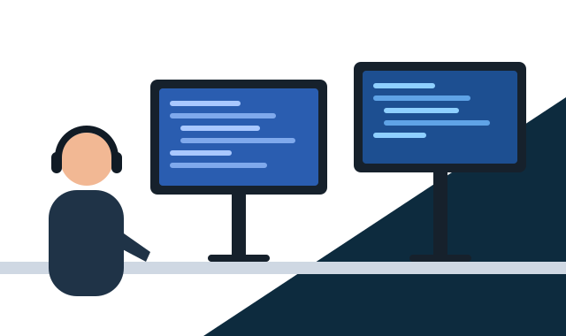

### &gt; Hi there, I'm [Aditya Shakya](https://github.com/ainnefasarome) 👋

<a href="#"></a>
<a href="#"></a>
<a href="#"></a>
<a href="#"></a>
<a href="#"></a>
<a href="#"></a>

### Glad to see you here! 

I am the developer of [Archcraft](https://archcraft.io), Which is an open-source Linux distribution based on [Arch Linux](https://archlinux.org).

I love spending my time creating something that not only looks good but also perfectly usable and practical. That being said, Archcraft came to life. I've been creating, updating and maintaining it for the last 3 years.

**Talking about Personal Stuffs:**



- 🔭 I'm currently working on something cool
- 🌱 I'm currently learning Web Development
- 💬 Ask me about anything, I am happy to help
- ⚡ I regularly create new stuff for [Archcraft](https://archcraft.io)
- 📫 How to reach me: [adi1090x@gmail.com](mailto:adi1090x@gmail.com)

<br clear="right">

**📊 This Week I Spent My Time On:**

```text
No activity tracked
```

**📈 My GitHub Stats:**


